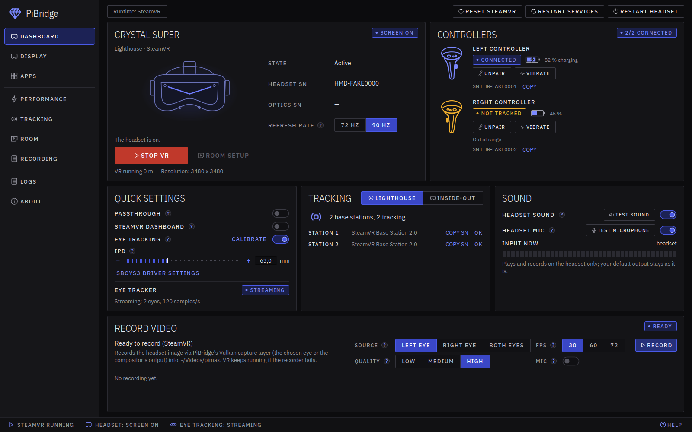
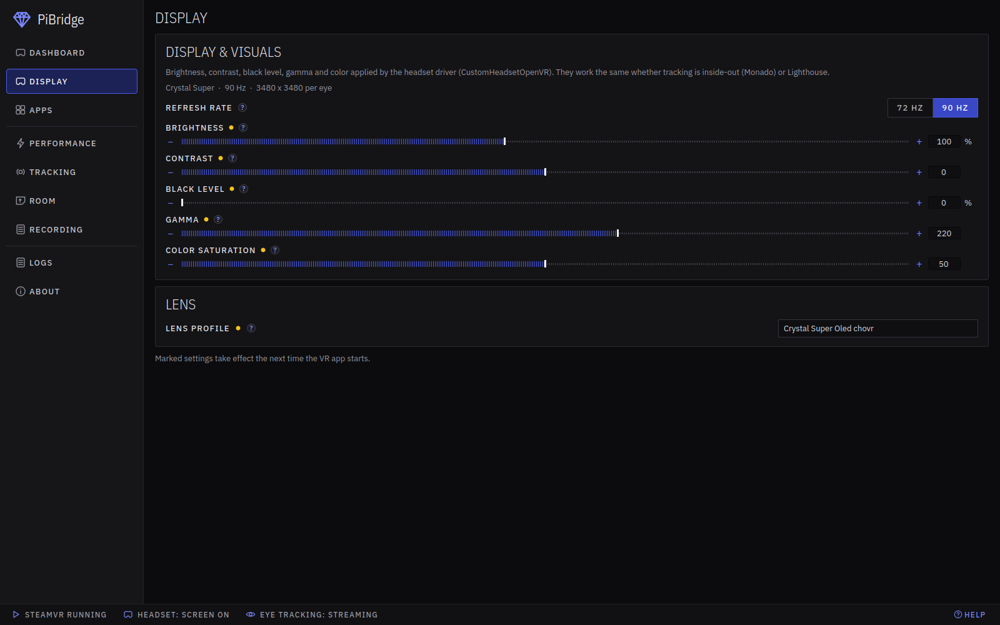
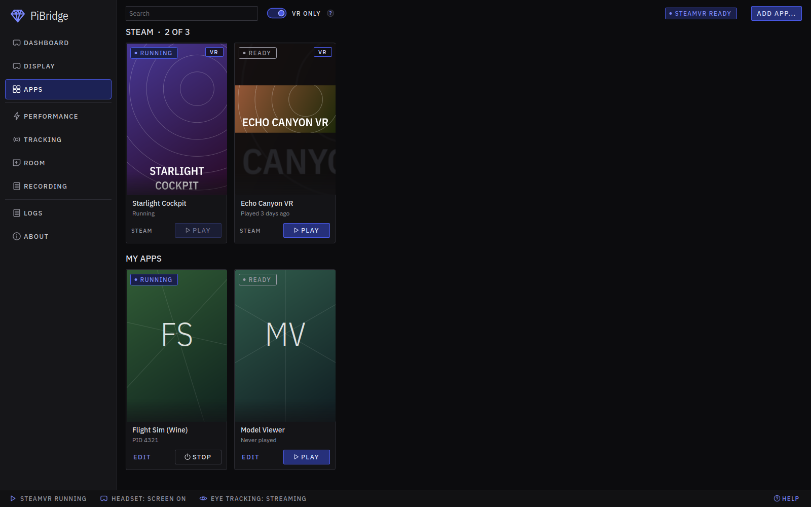
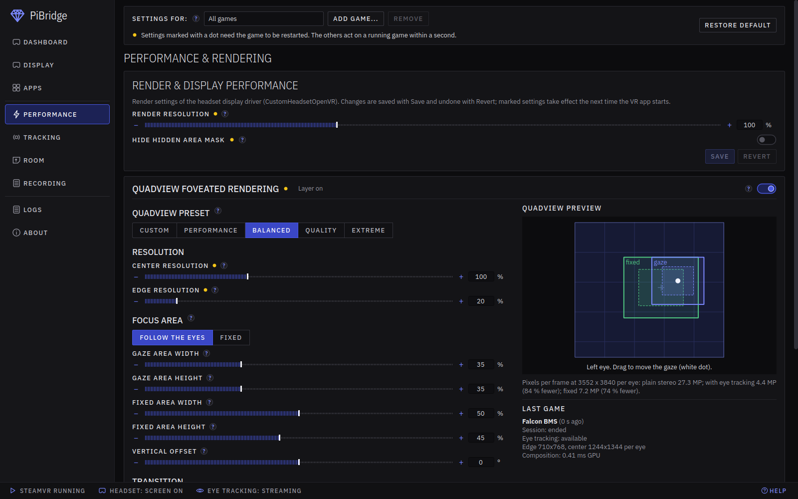
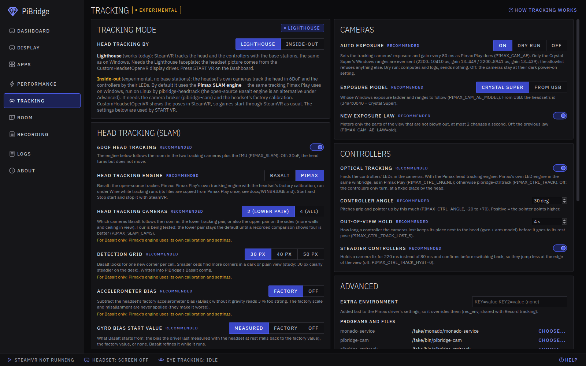
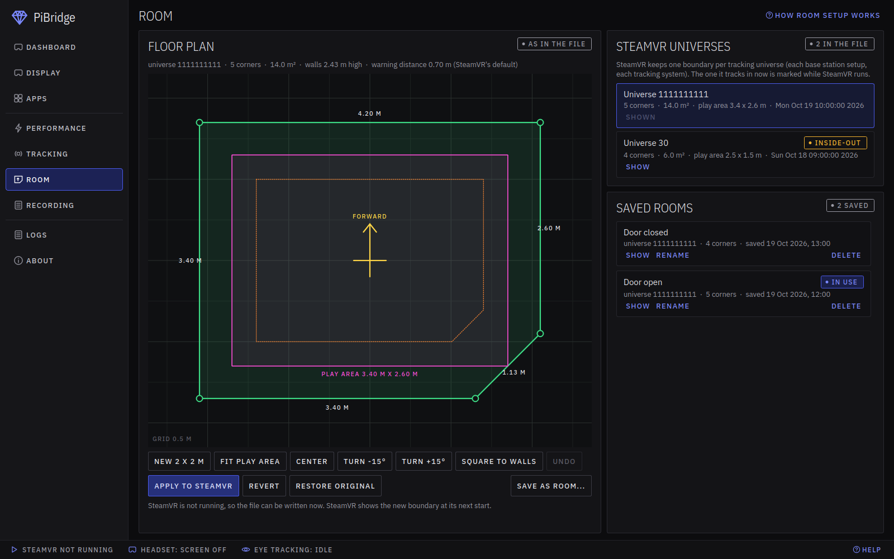
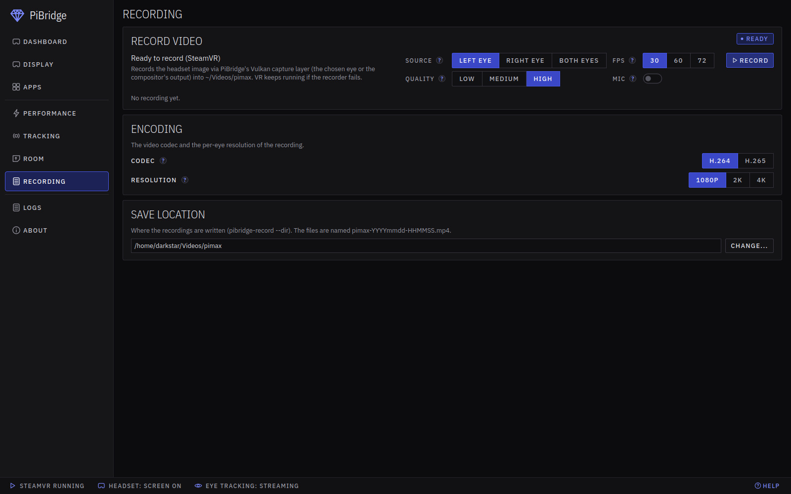

# PiBridge: the user guide

**One app for your Pimax headset on Linux.** PiBridge wakes the headset, keeps it awake while you play, runs its eye
tracker, switches the sound to it, and gives you one window where everything about the headset lives: the display, the
controllers, the tracking, the room boundary, foveated rendering and recording. SteamVR is the runtime that actually
runs your games; PiBridge is the hub around it.

You never need the command line. Every switch, button and page described here is in the app. The one-time setup (the
driver, the display patch, the SteamVR display driver) is in [INSTALL.md](INSTALL.md); after that, you open PiBridge,
press **START VR**, and play.

PiBridge works with the Pimax Crystal Super and with the original Pimax Crystal, each with Lighthouse tracking (base
stations) or with the headset's own inside-out tracking.

This is an unofficial community project. It is not made or supported by Pimax, and it is still young: expect rough
edges.

## The idea

Pimax Play on Windows is one program that does everything: it wakes the headset, shows its state, holds the settings,
pairs the controllers, sets up your room. PiBridge is that program for Linux. It talks to small background helpers that
do the real work with the hardware:

- **`pibridge-keepalived`** wakes the headset, keeps it awake while SteamVR runs, switches the panel on at your chosen
  refresh rate, and makes the headset the default sound device. When SteamVR closes, it hands everything back and the
  headset goes to standby (the LED turns green).
- **`pibridge-eyed`** runs the eye tracker and feeds your gaze to SteamVR and to games.
- **`pibridge-headtrack`** does the inside-out tracking, when you use it (see Tracking below).

You do not start or stop these by hand. They follow SteamVR on their own, and the app shows what they are doing.

## A normal session

1. Open **PiBridge** from your application menu.
2. Press **START VR** on the Dashboard (or start a VR game from the **Apps** page or from Steam). SteamVR starts, the
   headset wakes, the panel turns on, and the sound moves to the headset.
3. Put the headset on and play. Pair controllers, set up your room and change settings from the app whenever you like.
4. Press **STOP VR** (or close SteamVR). A few seconds later the sound returns to your speakers and the headset goes to
   standby.

The Dashboard shows the whole state at a glance, and the bar along the bottom of the window always shows whether
SteamVR is running, whether the headset screen is on and whether the eye tracker is streaming. **HELP** at the bottom
right opens this guide.

## The pages

The left menu has one page per part of the headset: **DASHBOARD**, **DISPLAY**, **APPS**, **PERFORMANCE**,
**TRACKING**, **ROOM**, **RECORDING**, **LOGS** and **ABOUT**. Here is what each one is for.

### Dashboard

Your home screen and the state of everything.

Across the top:

- **RESET STEAMVR** fully restarts SteamVR: it closes all of its processes (also a stuck one that keeps SteamVR from
  starting) after you confirm, and starts it again. When no SteamVR is running, it offers to restart Steam.
- **RESTART SERVICES** restarts the headset and eye-tracking helpers.
- **RESTART HEADSET** restarts the headset helper, which wakes the headset again.

The **Headset** card:

- **START VR** starts SteamVR (and, in inside-out mode, the headset's own tracking). While VR runs the same button is a
  red **STOP VR**. On the original Crystal, **STOP VR** also switches the headset off.
- **ROOM SETUP** starts the room setup in the headset. It works only in inside-out mode, while SteamVR runs.
- The headset's **STATE** and **SERIAL**, how long VR has been running, and the resolution.
- **REFRESH RATE**: **72 / 90 Hz**. It takes effect the next time the headset wakes.
- On the original Crystal: **72 / 90 / 120 Hz** instead (a running SteamVR is restarted for the change), its battery
  level, and a **SWITCH OFF** button. The Crystal is switched on with its own power button.

The **Controllers** card shows each controller: its model, a **CONNECTED** / **NOT TRACKED** chip (with the reason
when it is not tracked), the battery and the serial number with **COPY**. Under each one:

- **PAIR** when the controller is not active.
- **UNPAIR** and **VIBRATE** when it is active.

**Quick settings**:

- **PASSTHROUGH**: see your room through the headset cameras.
- **STEAMVR DASHBOARD**: puts a small PiBridge tab in the SteamVR dashboard, so you can start room setup from inside
  VR with the controller (see [OVERLAY.md](OVERLAY.md)).
- **EYE TRACKING**: the switch turns eye tracking on or off. **CALIBRATE** runs the eye tracker's own calibration in
  the headset, the way Pimax Play does it.
- **IPD**: the distance between your eyes. Moving the slider moves the lens motors and renders with the same distance.
  On the original Crystal the slider is locked: set the IPD with the buttons on the headset.
- The **EYE TRACKER** box shows whether it is streaming and which calibration it uses, with a live dot for your gaze.

The **Tracking** card:

- **LIGHTHOUSE / INSIDE-OUT** chooses how the headset is tracked. Switching restarts SteamVR when it is running.
- In Lighthouse mode it lists your base stations, whether each one is seen, and **COPY SN** for each.
- **SETTINGS** opens the tracking settings.

The **Sound** card:

- **HEADSET SOUND**: **TEST SOUND** plays a low tone on the left ear, then a high one on the right; the switch makes the headset the default sound output
  while it is on.
- **HEADSET MIC**: **TEST MICROPHONE** records a few seconds from the headset microphone and plays them back in the
  headset (start VR first: the microphone is silent while the screen is off); the switch makes the headset
  microphone the default input while it is on.
- **INPUT NOW**: which input is in use. The level meter below shows the microphone level during the test.

The **Record video** card records what the headset shows (see Recording below).

### Display

How the picture looks, whatever tracking you use.

- **REFRESH RATE**: the same switch as on the Dashboard.
- **BRIGHTNESS**, **CONTRAST**, **BLACK LEVEL**, **GAMMA** and **COLOR SATURATION**.
- **LENS PROFILE**: the lens shape the picture is drawn for in inside-out mode (Lighthouse uses the headset driver's own
  profile).

Settings marked with a dot take effect the next time a VR app starts.

### Apps

Your Steam games and your own programs, shown as cover tiles like a game library.

- A search box and a **VR ONLY** filter.
- **ADD APP...** adds a program of your own: its path, arguments, working folder, environment and icon, and whether to
  use foveated rendering (quad views) for it. **EDIT** on its tile changes it later.
- **PLAY** on a tile. If SteamVR is not running yet, PiBridge starts it first and waits until it is fully ready, then
  launches the game. Your own apps show **STOP** while running.

### Performance

Render quality and foveated rendering (quad views).

- **SETTINGS FOR**: all games, or a single game's profile. **ADD GAME...** and **REMOVE** manage the profiles,
  **RESTORE DEFAULT** goes back to the defaults.
- **Render & display performance**: **RENDER RESOLUTION** and **HIDE HIDDEN AREA MASK**, with **SAVE** and
  **REVERT**.
- **Quadview foveated rendering**: draws the middle of your view at full detail and the edges at lower detail, which
  saves a lot of GPU work. With eye tracking on, the sharp area follows your eyes; without it, it sits in the middle.
  - An on/off switch and a **QUADVIEW PRESET** (Custom, Performance, Balanced, Quality, Extreme).
  - **CENTER RESOLUTION** and **EDGE RESOLUTION**.
  - **FOCUS AREA**: **FOLLOW THE EYES** or **FIXED**, the size of each area, the vertical offset, the blend at the edge,
    sharpening and more.
  - **QUADVIEW PREVIEW** shows the areas to scale (drag the white dot to move the gaze) and how many pixels are saved.
    **LAST GAME** shows what the last game actually used.

Settings marked with a dot need the game to be restarted; the others act on a running game within a second. The
foveated-rendering layer is installed alongside PiBridge; see [INSTALL.md](INSTALL.md).

### Tracking

The settings for **inside-out** tracking (the headset's own cameras, no base stations). With Lighthouse (base stations)
there is nothing to set here. You choose the mode on the Dashboard or at the top of this page, and start VR with
**START VR** on the Dashboard.

Inside-out tracking is experimental. It runs in `pibridge-headtrack`, and by default it uses Pimax's own tracking
engine, the same one Pimax Play uses on Windows (its files are copied once from a Pimax Play install, see
[WINBRIDGE.md](WINBRIDGE.md)). Basalt, an open-source tracker, is the alternative. SteamVR shows the tracking through
the headset display driver, so games start through SteamVR as usual. The original Pimax Crystal does its inside-out
tracking itself.

- **Head tracking**: 6DoF on or off, the **HEAD TRACKING ENGINE** (**PIMAX** or **BASALT**), and Basalt's own settings
  (marked "For Basalt only").
- **Cameras**: the tracking cameras' auto exposure.
- **Controllers**: optical tracking of the controllers, the controller angle, how long a controller the cameras lost
  keeps its place, and steadier controllers.
- **Advanced**: extra settings for testing, the programs and files used, what a start sets, and **RESET TO
  RECOMMENDED**.

Every setting has a one-line explanation and a **RECOMMENDED** value. **HOW TRACKING WORKS** opens
[TRACKING.md](TRACKING.md) with the full detail.

### Room

Set up your play space: the boundary SteamVR shows when you come near a wall, the floor, and the centre and forward
direction games use. **HOW ROOM SETUP WORKS** opens [ROOM-SETUP.md](ROOM-SETUP.md) with the step-by-step.

- **Set up your playspace** (inside-out only): enter your body height, press **SETUP PLAYSPACE** and put the headset
  on. You see your room through the cameras; look slowly around, then stand still and look forward. The floor, the
  centre and forward are saved and come back by themselves at every start.
- A top-down **floor plan** you can edit on the desktop: drag a corner, double-click a wall to add a corner,
  right-click a corner to delete it. **NEW 2 X 2 M**, **FIT PLAY AREA**, **CENTER**, **TURN -15°** / **TURN +15°**,
  **SQUARE TO WALLS** and **UNDO**.
- **APPLY TO STEAMVR** writes your changes into SteamVR's boundary (a backup is kept first). It is only available
  while SteamVR is **not** running, because SteamVR keeps the boundary in memory and would overwrite a desktop change.
  **REVERT** goes back to what SteamVR's boundary file holds now, **RESTORE ORIGINAL** to the boundary from before PiBridge changed
  anything.
- **SteamVR universes**: SteamVR keeps one boundary per tracking setup (each base station setup, and inside-out).
  **SHOW** puts one on the floor plan.
- **Saved rooms** you can switch between (for example "Door open" and "Door closed"): **SAVE AS ROOM...**, then
  **SHOW**, **RENAME** or **DELETE**.

In inside-out mode you can also set up the room in the headset with **ROOM SETUP** on the Dashboard, or from the
PiBridge tab in the SteamVR dashboard (see [OVERLAY.md](OVERLAY.md)).

### Recording

Record what you see in the headset to a video file.

- **Record video**, the same card as on the Dashboard: the **SOURCE** (left eye, right eye or both), the **FPS**, the
  **QUALITY** and the **MIC** switch to include your voice, then **RECORD** (and **STOP**). VR keeps running if the
  recorder fails.
- **Encoding**: the **CODEC** (H.264 plays everywhere; H.265 makes smaller files) and the **RESOLUTION** (1080p, 2K or
  4K).
- **Save location**: where the files go (by default `~/Videos/pimax`); **CHANGE...** picks another folder.

### Logs and About

- **Logs**: the live output of the background services and of the foveated-rendering layer, in plain text, for when
  something needs looking into.
- **About**: the version, the licence, what PiBridge is built on, and where its settings live.

## Eye tracking

Eye tracking drives the gaze-following foveated rendering and is available to games through SteamVR. Calibrate once
with **CALIBRATE** on the Dashboard: it runs the eye tracker's own calibration in the headset, and the headset then
applies your calibration itself, as it does under Windows. The full setup is in [INSTALL.md](INSTALL.md).

Your eye profile and calibration files hold your personal eye data. They stay on your computer and are never shared.

## Getting help

- **HELP** at the bottom right opens this guide; **CONTENTS** and **BACK** move around in it, and links to the other
  guides open in the same window.
- The **Logs** page shows what the services and the layer are doing.
- If a control is greyed out, its tooltip says why (for example, that it needs SteamVR running, or a tool that was not
  found). The small **?** next to a setting explains it.
- More detail: [INSTALL.md](INSTALL.md), [TRACKING.md](TRACKING.md), [ROOM-SETUP.md](ROOM-SETUP.md),
  [OVERLAY.md](OVERLAY.md) and [WINBRIDGE.md](WINBRIDGE.md).

PiBridge is independent and not affiliated with Pimax. Pimax, Crystal, Crystal Super and Dream Air are trademarks of
their owners, used here only to say which hardware PiBridge works with.
